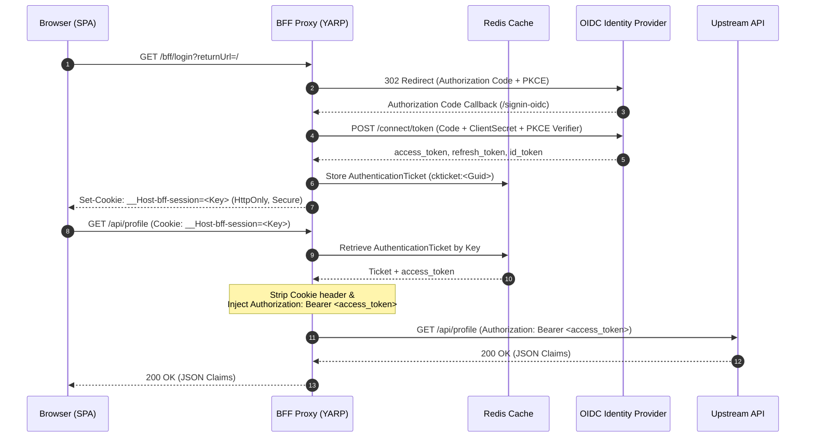

# Backend-for-Frontend (BFF) Security Proxy

A zero-trust **Backend-for-Frontend (BFF) Security Gateway** designed to secure Single-Page Applications (SPAs) and frontend workloads. Implemented in **.NET 10 (C# / YARP)** (with a co-located **Go** implementation planned), this project implements the **OAuth 2.0 / OpenID Connect (OIDC) Confidential Client** pattern—terminating tokens at the edge, managing hardened `HttpOnly` distributed sessions in **Redis**, and translating browser cookies into `Authorization: Bearer` headers for upstream microservice APIs.

---

## Table of Contents

1. [TL;DR](#tldr)
2. [Structural Overview](#1-structural-overview)
   - [Tech Stack](#tech-stack)
   - [Directory Layout](#directory-layout)
   - [Entry Points](#entry-points)
3. [Architectural Patterns](#2-architectural-patterns)
   - [Core Logic](#core-logic)
   - [Data Flow](#data-flow)
   - [Design Patterns](#design-patterns)
4. [Key Modules & Dependencies](#3-key-modules--dependencies)
   - [Critical Components](#critical-components)
   - [External Integrations](#external-integrations)
5. [Quick-Start Intelligence](#4-quick-start-intelligence)
   - [Environment & Configuration](#environment--configuration)
   - [Running Locally](#running-locally)
   - [Docker & Production Setup](#docker--production-setup)
   - [Testing & Verification](#testing--verification)
6. [Architecture Summary](#5-architecture-summary)
   - [The "Big Map"](#the-big-map)
   - [The "Golden Path"](#the-golden-path)
   - [Potential Friction & Gotchas](#potential-friction--gotchas)

---

## TL;DR

Instead of exposing OAuth 2.0 / OIDC tokens (`access_token`, `refresh_token`, `id_token`) to browser storage (`localStorage` / `sessionStorage`), the BFF acts as an **OIDC Confidential Client** using Authorization Code Flow + PKCE. It authenticates the user against an upstream Identity Provider, caches the resulting `AuthenticationTicket` and token set inside **Redis** (`AppTicketStore`), and issues a hardened, `HttpOnly` session cookie (`__Host-bff-session`) to the browser. When the SPA invokes `/api/*`, **YARP** authenticates the cookie, resolves the `access_token` from Redis, injects an `Authorization: Bearer <token>` header (`AccessTokenRequestTransform`), strips all browser cookies to prevent session leakage, and proxies the request to target microservices.

---

## 1. Structural Overview

### Tech Stack
* **Runtime & Framework:** **.NET 10.0** (`net10.0`), ASP.NET Core Minimal APIs.
* **Reverse Proxy Engine:** **YARP (Yet Another Reverse Proxy)** (`Yarp.ReverseProxy` v2.3.0).
* **Authentication & Identity:**
  * `Microsoft.AspNetCore.Authentication.OpenIdConnect` (v10.0.15) & Cookie Authentication at the BFF edge.
  * `Microsoft.AspNetCore.Authentication.JwtBearer` (v10.0.15) in the sample upstream resource server.
* **Distributed State & Caching:** **Redis** via `Microsoft.Extensions.Caching.StackExchangeRedis` (v11.0.0).
* **Observability & Logging:** **Serilog** (`Serilog.AspNetCore` v10.0.0) with structured JSON console output (`Serilog.Formatting.Compact` v3.0.0).
* **Containerization:** Multi-stage Alpine Linux Docker build (`Dockerfile.yarp`).

### Directory Layout
The repository follows a **Multi-Host Gateway / Edge-Proxy Architecture**. Because the BFF is a **generic security and routing gateway**, it deliberately avoids Domain-Driven Design (DDD) layers—domain and business logic belong strictly in upstream microservices.

```text
backend-for-frontend/
├── .vscode/
│   ├── launch.json                          # Debug profiles (BFF-Proxy, BFF-Upstream, and compound Test-Stack)
│   └── tasks.json                           # Build tasks for proxy and sample upstream
├── docs/
│   └── dev/
│       ├── 0001_jwe_access_token_validation.md # ADR on JWE vs. JWS access token validation
│       └── 0002_setup.md                       # Docker image & production setup guide (Dockerfile.yarp)
├── src/
│   ├── ApogeeDev.Bff.Yarp.Host/             # .NET 10 Generic BFF Proxy (YARP)
│   │   ├── Properties/launchSettings.json   # Local dev ports (HTTP :5084, HTTPS :7033)
│   │   ├── Services/
│   │   │   └── AppTicketStore.cs            # Redis-backed ITicketStore for cookie sessions
│   │   ├── Transforms/
│   │   │   └── AccessTokenRequestTransform.cs # Injects Bearer token & strips Cookie header
│   │   ├── Program.cs                       # Bootstrap, middleware pipeline, Minimal API BFF endpoints, YARP mapping
│   │   ├── Startup.cs                       # DI registration: Serilog, Cookie+OIDC Auth, YARP, Antiforgery, Redis
│   │   ├── appsettings.json                 # Base config: Serilog, AppOptions (/bff/* paths), Oidc defaults
│   │   ├── appsettings.Development.json     # Dev YARP routes (/api/{**catch-all}) & clusters (localhost:5065)
│   │   └── secrets.json                     # Local uncommitted secrets (gitignored)
│   ├── ApogeeDev.Sample.Backend.Host/       # Sample Upstream Protected API (.NET 10)
│   │   ├── Properties/launchSettings.json   # Local dev ports (HTTP :5065, HTTPS :7007)
│   │   ├── Program.cs                       # JWT Bearer validation & sample GET /api/profile endpoint
│   │   └── appsettings.Development.json     # Upstream OIDC Authority & Audience config
│   └── go-bff/                              # (Planned/Reserved) Golang Generic BFF Proxy implementation
├── AGENTS.md                                # Contextual architectural anchor for AI coding agents
├── Dockerfile.yarp                          # Multi-stage Alpine .NET 10 production image
└── README.md
```

### Entry Points
* **BFF Edge Proxy (`ApogeeDev.Bff.Yarp.Host`):** `src/ApogeeDev.Bff.Yarp.Host/Program.cs`
  * Local Development: `http://localhost:5084` / `https://localhost:7033`
  * Docker Container: `http://*:5000`
* **Sample Upstream API (`ApogeeDev.Sample.Backend.Host`):** `src/ApogeeDev.Sample.Backend.Host/Program.cs`
  * Local Development: `http://localhost:5065` / `https://localhost:7007`

---

## 2. Architectural Patterns

### Core Logic
The BFF contains **no domain business rules**. Its core security mediation resides in three focused locations:
1. **OIDC & Cookie Session Wiring:** `src/ApogeeDev.Bff.Yarp.Host/Startup.cs`
2. **Distributed Session Ticket Persistence:** `src/ApogeeDev.Bff.Yarp.Host/Services/AppTicketStore.cs`
3. **Cookie-to-Bearer Request Transformation:** `src/ApogeeDev.Bff.Yarp.Host/Transforms/AccessTokenRequestTransform.cs`

### Data Flow



### Design Patterns
* **Zero-Trust Browser Token Mediation:** Browser clients never touch OAuth tokens. The BFF acts as an OIDC Confidential Client (`response_type=code`, `SaveTokens=true`).
* **Server-Side Session Store (`ITicketStore`):** Prevents cookie bloat and protects token payloads by persisting serialized `AuthenticationTicket` instances in Redis while issuing only an opaque reference key in the `__Host-bff-session` cookie.
* **Proxy Request Interceptor (`ITransformProvider`):** Hooks into YARP's request pipeline to attach `Authorization: Bearer <token>` and strip `Cookie` headers before forwarding.
* **Strict Middleware Ordering:**
  1. `UseSerilogRequestLogging()`
  2. `UseDefaultFiles()` & `UseStaticFiles()`
  3. `UseRouting()`
  4. `UseAuthentication()`
  5. `UseAuthorization()`
  6. BFF Management Endpoints (`/bff/login`, `/bff/logout`, `/bff/userinfo`)
  7. `MapReverseProxy()`
  8. `MapFallbackToFile("index.html")` & `MapHealthChecks("/health")`

---

## 3. Key Modules & Dependencies

### Critical Components
1. **`src/ApogeeDev.Bff.Yarp.Host/Startup.cs`**: Registers DI services—Cookie + OIDC authentication (`ResponseType = Code`, `UsePkce = true`, `SaveTokens = true`), custom claim mappings, Antiforgery (`__Host-XSRF-TOKEN` / `X-XSRF-TOKEN`), Redis cache with `redis://` URI parsing, and YARP config loading.
2. **`src/ApogeeDev.Bff.Yarp.Host/Program.cs`**: Configures the bootstrap Serilog logger, layered configuration (`appsettings`, `secrets.json`, `BFF_` env vars), middleware pipeline, BFF management Minimal APIs (`/bff/login`, `/bff/logout`, `/bff/userinfo`), YARP proxy endpoints, `/health` check, and SPA fallback (`index.html`).
3. **`src/ApogeeDev.Bff.Yarp.Host/Transforms/AccessTokenRequestTransform.cs`**: Implements YARP's `ITransformProvider` to extract `access_token` via `HttpContext.GetTokenAsync("access_token")`, attach `Authorization: Bearer <token>`, and strip the `Cookie` header.
4. **`src/ApogeeDev.Bff.Yarp.Host/Services/AppTicketStore.cs`**: Implements `ITicketStore` over `IDistributedCache` using `TicketSerializer.Default` to store, retrieve, renew, and remove authentication tickets in Redis.
5. **`src/ApogeeDev.Sample.Backend.Host/Program.cs`**: Reference upstream API demonstrating stateless JWT Bearer validation via OIDC discovery and exposing `GET /api/profile`.

### External Integrations
* **OIDC Identity Provider:** Any compliant OIDC authority (e.g., OpenIddict / `ApogeeDev.IdentityProvider.Host`, Duende IdentityServer, Keycloak, ZITADEL, Entra ID) supporting Authorization Code flow + PKCE and Refresh Tokens (`offline_access`).
* **Redis:** Distributed cache backing `AppTicketStore`, namespaced by `<AppName>:<EnvironmentName>:`.

---

## 4. Quick-Start Intelligence

### Environment & Configuration
Configuration is loaded in `src/ApogeeDev.Bff.Yarp.Host/Program.cs` in the following order (later sources override earlier ones):
1. `appsettings.json`: Base Serilog config, `AppOptions` (`/bff/login`, `/bff/logout`, `/bff/userinfo`, `AppName`), and default `Oidc` settings.
2. `appsettings.{Environment}.json`: Declarative YARP `ReverseProxy` routes (`/api/{**catch-all}`) and upstream cluster destinations (`http://localhost:5065`).
3. `secrets.json` *(gitignored)*: Local developer secrets (`ConnectionStrings:Redis`, `Oidc:Authority`, `Oidc:ClientId`, `Oidc:ClientSecret`).
4. **Environment Variables (`BFF_` prefix):** All environment variable overrides must be prefixed with `BFF_`:

| Environment Variable | Configuration Path | Description |
| :--- | :--- | :--- |
| `BFF_ConnectionStrings__Redis` | `ConnectionStrings:Redis` | **Required.** Redis connection string or `redis://` / `rediss://` URI. |
| `BFF_Oidc__Authority` | `Oidc:Authority` | OIDC Identity Provider URL (e.g., `https://localhost:5001`). |
| `BFF_Oidc__ClientId` | `Oidc:ClientId` | OIDC Confidential Client ID. |
| `BFF_Oidc__ClientSecret` | `Oidc:ClientSecret` | OIDC Confidential Client Secret. |
| `BFF_AppOptions__AppName` | `AppOptions:AppName` | Prefix used for Redis instance key namespacing. |

Example `src/ApogeeDev.Bff.Yarp.Host/secrets.json`:
```json
{
  "ConnectionStrings": {
    "Redis": "redis://localhost:6379"
  },
  "Oidc": {
    "Authority": "https://localhost:5001",
    "ClientId": "bff-yarp-host",
    "ClientSecret": "your-client-secret"
  }
}
```

### Running Locally

```powershell
# 1. Build the BFF YARP Proxy
dotnet build src/ApogeeDev.Bff.Yarp.Host/ApogeeDev.Bff.Yarp.Host.csproj

# 2. Build the Sample Upstream Backend
dotnet build src/ApogeeDev.Sample.Backend.Host/ApogeeDev.Sample.Backend.Host.csproj

# 3. Run the Sample Upstream Backend (HTTP :5065 / HTTPS :7007)
dotnet run --project src/ApogeeDev.Sample.Backend.Host/ApogeeDev.Sample.Backend.Host.csproj

# 4. Run the BFF YARP Proxy (HTTP :5084 / HTTPS :7033)
dotnet run --project src/ApogeeDev.Bff.Yarp.Host/ApogeeDev.Bff.Yarp.Host.csproj
```

Or launch both services together in VS Code using the **`Test-Stack (BFF + Upstream)`** compound configuration in `.vscode/launch.json`.

### Docker & Production Setup
For building and running the containerized BFF proxy using [`Dockerfile.yarp`](./Dockerfile.yarp)—including mounting your compiled SPA bundle to `/home/app/wwwroot`, overriding YARP upstream routes via `appsettings.Production.json`, and injecting secrets with `BFF_` environment variables—see the **[Docker Setup & Production Deployment Guide (`docs/dev/0002_setup.md`)](./docs/dev/0002_setup.md)**.

### Testing & Verification
1. Start Redis, your OIDC Identity Provider, `ApogeeDev.Sample.Backend.Host`, and `ApogeeDev.Bff.Yarp.Host`.
2. Navigate to `https://localhost:7033/bff/login` to authenticate via the Identity Provider.
3. Verify session claims at `https://localhost:7033/bff/userinfo`.
4. Call the proxied upstream API at `https://localhost:7033/api/profile` and verify that your JWT claims are returned by `ApogeeDev.Sample.Backend.Host`.

---

## 5. Architecture Summary

### The "Big Map"
* **`.vscode/`**: Debug profiles (`BFF-Proxy`, `BFF-Upstream`, and `Test-Stack` compound runner) and build tasks.
* **`docs/dev/`**: Architectural Decision Records (ADRs), setup guides, and deep-dive troubleshooting notes (see [`0001_jwe_access_token_validation.md`](./docs/dev/0001_jwe_access_token_validation.md) and [`0002_setup.md`](./docs/dev/0002_setup.md)).
* **`src/ApogeeDev.Bff.Yarp.Host/`**: Primary .NET 10 YARP BFF Security Proxy host.
  * **`Services/`**: Redis-backed `ITicketStore` (`AppTicketStore`) for server-side cookie session persistence.
  * **`Transforms/`**: YARP request transform (`AccessTokenRequestTransform`) that swaps cookies for Bearer tokens.
* **`src/ApogeeDev.Sample.Backend.Host/`**: Sample downstream microservice API (`GET /api/profile`) protected by `JwtBearer` authentication.
* **`Dockerfile.yarp`**: Production Alpine `.NET 10` multi-stage container definition exposing port `5000` and `/health`.

### The "Golden Path"
Tracing an authenticated upstream API call (`GET /api/profile`):
1. **Login Initiation (`GET /bff/login?returnUrl=/dashboard`):**
   * Handled in `Program.cs`. Validates `returnUrl` via `RedirectHttpResult.IsLocalUrl(returnUrl)` to prevent open redirects, then triggers an OIDC `Results.Challenge(...)`.
2. **OIDC Code Exchange & Redis Ticket Storage:**
   * After user authentication at the IdP, the OIDC middleware exchanges the authorization code (+ PKCE verifier and `ClientSecret`) for `access_token`, `refresh_token`, and `id_token`, fetches additional claims from the UserInfo endpoint, and invokes `AppTicketStore.StoreAsync`.
   * `AppTicketStore` serializes the `AuthenticationTicket` into Redis under `<AppName>:<Env>:ckticket:<Guid>` and sets the `__Host-bff-session` cookie in the browser containing only the encrypted reference key.
3. **Browser API Request (`GET /api/profile`):**
   * The SPA makes a `fetch('/api/profile')` call; the browser automatically attaches `Cookie: __Host-bff-session=...`.
4. **Session Hydration & Route Authorization:**
   * `app.UseAuthentication()` reads the cookie key and calls `AppTicketStore.RetrieveAsync` to rehydrate `HttpContext.User` and its saved tokens from Redis.
   * `app.UseAuthorization()` verifies the user satisfies `route1`'s `AuthorizationPolicy: "Default"` defined in `appsettings.Development.json`.
5. **Cookie-to-Bearer Transformation:**
   * `app.MapReverseProxy()` matches `/api/{**catch-all}` and executes `AccessTokenRequestTransform.Apply`:
     * Calls `await httpContext.GetTokenAsync("access_token")`.
     * Sets `ProxyRequest.Headers.Authorization = new AuthenticationHeaderValue("Bearer", accessToken)`.
     * Executes `ProxyRequest.Headers.Remove("Cookie")` so the session cookie never leaks to internal services.
6. **Upstream Execution (`http://localhost:5065/api/profile`):**
   * `ApogeeDev.Sample.Backend.Host` validates the JWT signature against the IdP's public JWKS and returns the caller's claims as JSON.

### Potential Friction & Gotchas
* **Fail-Fast Redis Startup Dependency:** `Startup.cs` throws `InvalidOperationException("missing redis configuration")` immediately on boot if `ConnectionStrings:Redis` is absent. Ensure Redis is running and configured in `secrets.json` or via `BFF_ConnectionStrings__Redis`. (`Startup.cs` automatically converts `redis://host:port` and `rediss://host:port` URIs into StackExchange.Redis connection strings).
* **JWE vs. JWS Access Tokens (`IDX10609: Decryption failed`):** As detailed in `docs/dev/0001_jwe_access_token_validation.md`, Identity Providers like OpenIddict encrypt access tokens as 5-segment **JWEs** by default. Standard upstream `JwtBearer` middleware cannot decrypt JWEs using public JWKS keys alone. Enable `SkipTokenEncryption` (`DisableAccessTokenEncryption`) on the BFF's OIDC client registration in your IdP so it issues 3-segment signed **JWS** access tokens.
* **`__Host-` Cookie Prefix Invariants:** Both `__Host-bff-session` and `__Host-XSRF-TOKEN` enforce the strict browser `__Host-` prefix (`Secure=Always`, `Path=/`, no `Domain` attribute). Browsers will reject these cookies over insecure non-localhost HTTP connections.
* **`SameSite` Cookie Configuration:** `Startup.cs` sets `SameSiteMode.Lax` on `__Host-bff-session` (paired with `ResponseMode = Query`) so the session cookie survives top-level OIDC redirect flows, while enforcing `SameSiteMode.Strict` on `__Host-XSRF-TOKEN`.
* **Token Refresh Lifecycle:** While `Startup.cs` requests the `offline_access` scope and persists `refresh_token` in Redis, `AccessTokenRequestTransform.cs` currently forwards the stored `access_token` directly without automatic background refresh on expiration.
